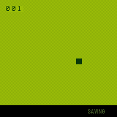
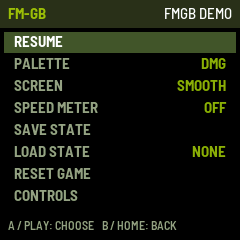
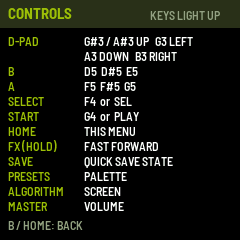

# FM-GB: a Game Boy for the M-VAVE FM-1

FM-GB is an emulator of the original Game Boy (DMG) that runs as the FM-1's firmware, built on
[fm1-base](../README.md) and felucca-bsp. You add your own game when you install it: you choose a ROM file, and it is
put into the firmware package on your computer, then installed over USB. No game comes with FM-GB.

**Status: new, and not yet run on a physical FM-1.** It builds with the FM-1's toolchain and passes fm1-base's build
checks, and it is tested in fm1-base's host simulator and with the usual Game Boy test ROMs (below). Expect to tune
it once it runs on the hardware: speed, the sound's latency, the keys' layout.

## Install it with your ROM

You need an FM-1 connected by USB, and a Game Boy ROM you own (`.gb`; a Color game that also runs on an original Game
Boy works too, in four shades).

**From the install page** (Chrome or Edge): open the page, choose your ROM, press *Make it*, then *Install*. The page
builds the package in the browser, so your ROM never leaves your computer. You can also download the package
(`.fwsc`) and install it with another tool. The page is published by this repository's `fm-gb` workflow on GitHub
Pages (Settings > Pages > Source: GitHub Actions), or serve it yourself:

    tools/setup_toolchain.sh               # once: the JieLi toolchain and the SDK's three files
    python3 tools/build.py gb              # the emulator: gb/build/fm-gb.fwsc (no game in it)
    python3 gb/tools/site.py               # the page and that package: gb/build/site/
    python3 -m http.server -d gb/build/site 8000      # then open http://localhost:8000

**From the command line** (Python 3, and `pip install mido python-rtmidi` for the install):

    python3 gb/tools/fm1gb.py install                  # a file dialog asks for the ROM; or give it: install game.gb
    python3 gb/tools/fm1gb.py pack game.gb -o game.fwsc     # the package only, nothing installed
    python3 gb/tools/fm1gb.py info game.fwsc           # what game a package holds

`fm1gb.py` builds the emulator first when `gb/build/fm-gb.fwsc` is not there (that needs the toolchain), or takes a
prebuilt one with `--base fm-gb.fwsc` (the workflow's artifact): putting a ROM in needs nothing but Python. The install
itself is fm1-base's `tools/fm1_install.py`.

To change the game, install again with another ROM. Each game's saves are kept apart from the others' (see Saves).

## Playing

The keys are the pad and the buttons. They light up dim on the keybed, and bright while held.

| Game Boy | FM-1 |
| --- | --- |
| Up | G#3 or A#3 (or F#3) |
| Left / Down / Right | G3 (or F3) / A3 / B3 (or C4) |
| B | D5, D#5 or E5 |
| A | F5, F#5 or G5 |
| Select | F4, or SEL |
| Start | G4, or PLAY |

| Button | What it does |
| --- | --- |
| HOME | The menu (the game pauses): palette, screen, speed meter, save state, load state, reset, controls |
| FX (held) | Fast forward (up to 4x, without sound) |
| SAVE | Quick save state |
| PRESETS | The next palette: DMG green, Pocket, gray, Light, amber, Color (the sprites in their own colours), night |
| ALGORITHM | The screen: smooth 1.5x, sharp 1.5x, or 1:1 |
| OCT- / OCT+ | The palette back and on |
| MASTER | Volume |

In the menu, SELECT or the pad moves, A or PLAY chooses, B or HOME goes back.

## Saves

- **Battery saves.** A game that saves to its cartridge keeps its saves in the FM-1's flash. FM-GB writes them shortly
  after the game saves (when it switches its RAM off), or a few seconds after it last wrote its RAM, at most once a
  minute, and never when nothing changed. Writes go as two copies, the newer whole one current, so switching off
  mid-save keeps the last save. The status bar says SAVING meanwhile. Opening the menu saves at once.
- **Save states.** SAVE (or the menu) keeps the whole machine. It is kept in the flash too when the game's battery saves
  leave room (games with 8 KiB of cartridge RAM or less), otherwise in RAM until the FM-1 is switched off. The menu
  says RAM ONLY then.
- **Settings** (palette, screen, speed meter) are kept when you leave the menu.
- MBC3's clock (a cartridge with a clock in it) runs while the game runs, and is kept with the save, but it does
  not run while the FM-1 is off.

Saves live in flash the firmware's update does not write (XDATA1, 0xE7000..0xFBFFF; settings at 0xFC000), so they
stay across reinstalls. Each save carries its game's name and checksum, and another game's is never loaded: a new
game simply starts without one (and its first save replaces the old game's).

## What it emulates, and what not

- The CPU (every instruction, the HALT bug, the interrupts), the PPU (a line at a time: background, window, 10 sprites a
  line with the DMG's priorities, the STAT interrupts), the timer, OAM DMA, the joypad, the APU's four channels
  (box-filtered to 44.1 kHz, the DMG's output high-pass) and serial (no cable: transfers end with nobody there).
- Cartridges: ROM only, MBC1, MBC2, MBC3 with its clock, MBC5 (and HuC1 as an MBC1); 32 KiB of cartridge RAM at most.
  Not supported: MBC6, MBC7, MMM01, HuC3, the Camera, MBC1 multicarts.
- The Game Boy Color's own mode: no. Color-only games are refused.
- No boot ROM (none is included): a game starts where the boot ROM leaves it.
- The timing is per instruction, not per memory access, and the PPU's mode 3 has a fixed length: games run, but a few
  timing test ROMs fail (below).
- The size of a game: the app slot holds the emulator and ~756 KiB of game. Games up to 512 KiB go in as they are.
  Bigger ones (1 MiB) have some of their 16 KiB banks LZ4-compressed when the package is made, as many as it takes,
  the best-compressing first; the FM-1 decompresses them into a cache of 8 banks as the game maps them. A game that
  does not compress enough does not fit, and the tools say so.

## How it works on the FM-1

- The emulator (`core/gb.c`) is plain C99, integers only. It runs in the main loop, as far ahead of the sound as a
  35 ms ring: the audio interrupt plays the ring, and the emulator runs until it is full enough again, so the sound's
  clock sets the game's speed.
- The screen is 240 x 240 on SPI. A frame done at VBlank goes out a strip at a time by DMA while the game runs on, and
  only the strips that changed. A whole frame at 1.5x takes ~19 ms on the SPI, so a game that redraws everything
  shows at 30 frames a second (the game itself runs at 60), and the frames that could not be shown are not drawn at
  all. 1:1 takes less than half the time. The speed meter (menu) shows the frames shown a second and the CPU used.
- The ROM sits at the end of the app slot (`app_end = 0xE0000`, the biggest slot), read in place from the flash. Its
  last 64 bytes are a trailer: where the game starts, its size, CRC-32s of both, whether its banks are compressed.
  `gb/tools/fm1gb.py` and `gb/web/fm1gb.js` write it into a built package (deciphering the app area, writing the slot,
  the directory's checksums again, enciphering it): the emulator is built once, and a game is added without a
  compiler. The two give the same bytes, which give the same bytes as fm1-base's own packager would from the app
  and the game (`gb/tools/test_fm1gb.py` checks all three).

| Part | |
| --- | --- |
| `core/gb.c`, `core/gb.h` | the emulator, its own unit at -O2 |
| `fast.c` | the screen's conversions (1.5x smooth, sharp, 1:1), a strip's hash, LZ4, at -O2 |
| `app.c` | the FM-1 app: the keys, the sound, the screen, the menu, save states |
| `rom.c` | the game: its trailer, its banks, the cache of compressed ones |
| `save.c` | battery saves in the flash |
| `tools/fm1gb.py` | the ROM into a package, and the install |
| `tools/mkdemo.py` | FM-GB's own test cartridge (and a tiny Game Boy assembler) |
| `tools/site.py`, `web/` | the install page |
| `test/gbtest.c` | the emulator on a computer, for test ROMs |
| `tests/` | the tests (`gb/tests/run.sh`) |

## Building and testing

    tools/setup_toolchain.sh                   # the pinned JieLi toolchain and SDK files (Linux x86-64; macOS: Docker)
    python3 tools/build.py gb                  # the firmware: gb/build/fm-gb.fwsc
    python3 tools/build.py gb --host           # the host simulator: gb/build/host/fm-gb_host
    FM1GB_ROM=game.gb gb/build/host/fm-gb_host gb/tests/demo.txt gb/build/test
    gb/tests/run.sh                            # everything below

`gb/tests/run.sh` runs FM-GB's own test cartridge (an original program, made by `gb/tools/mkdemo.py`) through the
emulator and through the app in the host simulator (the pad, the sound, a battery save across a power cycle, a save
state, the menu), then checks the ROM packers byte for byte, with a 1 MiB cartridge that only fits compressed.

The emulator was also checked against the public test ROMs (not in this repository):

| Suite | Result |
| --- | --- |
| Blargg's cpu_instrs (all 11), instr_timing, halt_bug | pass (cpu_instrs also through the app, with compressed banks) |
| dmg-acid2 | pass, pixel for pixel |
| Blargg's dmg_sound | 9 of 12 (not: reading and writing wave RAM while channel 3 plays) |
| Mooneye acceptance and emulator-only (DMG) | 58 of 94: the MBC1, MBC2 and MBC5 tests pass; the rest are per-access CPU timing, OAM DMA timing, the PPU's exact timings, the timer's reload delay, DMG-0 boot values |
| Blargg's mem_timing | fail (per-access timing) |

    cc -O2 -Igb/core -o gbtest gb/test/gbtest.c gb/core/gb.c
    ./gbtest cpu_instrs.gb -f 4000 -s -q       # -s the serial text, -q stop at Passed / Failed, -o screen.pgm, -m Mooneye

## Licence

FM-GB's files are MPL-2.0, like fm1-base's (see the repository's LICENSING.md for the parts that are not). Play the
games you own: FM-GB includes no ROM, fetches none and sends yours nowhere.
